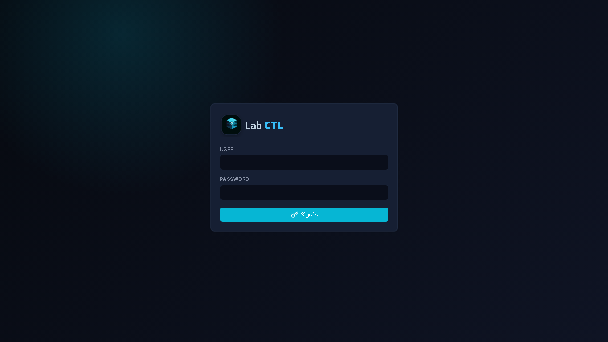
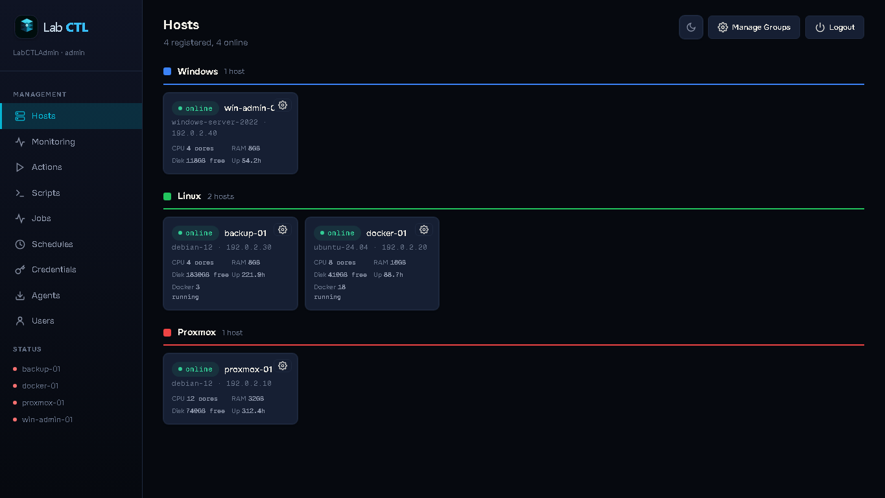

# LabCTL

LabCTL is one control plane for the machines you look after. It manages Linux, macOS and Windows hosts, VPS servers, Proxmox nodes, Docker hosts and GitHub Actions runners from a single browser dashboard.

It ships with:

- A Node.js server with a Preact dashboard. There is no build step and no CDN call.
- A single-file Python agent for Linux, macOS and Windows.
- Agentless SSH hosts, for machines where you do not want an agent.
- SQLite storage with encrypted credentials, an audit log and nightly backups.
- An update sidecar that upgrades LabCTL from the UI and rolls back on failure.





The screenshots use documentation demo hosts and example IP addresses. They come from the v1 interface and are kept until new ones are generated from a real v2 install.

Related documents:

- [docs/ARCHITECTURE.md](docs/ARCHITECTURE.md): modules, tables, API, protocol, security model and decisions.
- [docs/CHANGELOG.md](docs/CHANGELOG.md): what changed in each release.
- [docs/templates.md](docs/templates.md): job action templates and runbooks.
- [updater/README.md](updater/README.md): the update sidecar.

## Features

| Area | What you get |
| --- | --- |
| Fleet | Host list with live status, tags, groups, filters, fleet tiles, host detail pages with charts for CPU, RAM, disk and network, and per-host tabs for Docker, services, security, software updates, logs and jobs. |
| Agents | One Python file. Enrolment tokens, self-update with automatic roll back, watchdog, Linux, macOS and Windows installers. |
| Add host wizard | Install an agent over SSH, OpenSSH on Windows, WinRM or through a relay agent. Manual one-line installers as a fallback. |
| Agentless hosts | Jobs over SSH with a 60 second state poll and trust on first use for host keys. |
| Jobs | Live output over server-sent events, job groups across many hosts, retry of failed hosts, log search, 20 MiB log cap with head and tail kept. |
| Actions | Script templates for patching, cleanup, reboots, Docker, runners, VPS, Proxmox and Windows domain controller work. A command palette (Ctrl+K or Cmd+K) runs them. |
| Runbooks | Multi-step sequences with waits for the agent to come back and for a runner to show online in GitHub. |
| GitHub runners | Detection on hosts, GitHub API view, drain before work, update, roll back, clean up, re-register, remove. |
| VPS and Proxmox | Host kinds with WireGuard, fail2ban, certificate, unattended-upgrade and port checks, plus Proxmox guests, snapshots and backup report. |
| Monitoring | Retained metrics, alert rules with a default pack, alert history, silence and acknowledge. |
| Notifications | SMTP, generic webhook (for n8n and similar) and Telegram channels. Daily health report. |
| Patching | Patch rings (ring0, ring1, ring2) with a stop on failure, maintenance windows, post-update health checks. |
| Compliance | Per host patch age, backup age, reboot state, agent version and end-of-life report, with CSV export. |
| Operations | Nightly SQLite backup, config export and import, update check and one-click update, audit log with redaction, roles. |

## Quick start (Docker Compose)

### Requirements

- Docker with Compose v2.
- TCP port 7700 reachable from your browser and from the managed hosts.
- A secret store that can hand a value to the container as an environment variable.

### 1. Get the code

```bash
git clone https://github.com/tlaskar-git/LabCTL.git /opt/stacks/labctl
cd /opt/stacks/labctl
```

### 2. Create the master key

`LABCTL_MASTER_KEY` encrypts every stored credential. The server refuses to start without it. It must be 32 bytes as base64 or 64 hex characters.

```bash
npm run genkey --prefix server
```

If Node is not installed on the host, run `docker run --rm node:22-bookworm-slim node -e "console.log(require('crypto').randomBytes(32).toString('base64'))"`.

Store the value in your secret store. Supply it from the environment at start-up, through whatever launcher you use to inject environment variables. Do not write it into the compose file, an `.env` file in the repository or a shell history. The compose file only names the variable.

Losing the key makes every stored credential unreadable. Keep a copy that does not live on the LabCTL host.

### 3. Set the other variables

| Name | Needed | Purpose |
| --- | --- | --- |
| `LABCTL_MASTER_KEY` | Yes | Encrypts stored credentials. |
| `LABCTL_UPDATER_SECRET` | Yes, for the updater | Shared secret between `labctl` and `labctl-updater`. Any long random string. |
| `LABCTL_TAG` | No | Image tag to run. Default `latest`. Pin it (for example `v2.0.0`) to hold a version. |
| `LABCTL_REPO_DIR` | No | Git mode fallback only. Path of a host-maintained checkout, mounted at the same path in the sidecar. Leave it unset to build from the remote git context. |
| `LABCTL_GITHUB_TOKEN` | No | Read once on the first GitHub token save when no token is typed into the UI. Keep it in your secret store. |

### 4. Fix the data folder owner

The image runs as the non-root `node` user (uid 1000). The compose file mounts the repository's `data/` folder at `/app/data`.

```bash
mkdir -p data
sudo chown -R 1000:1000 data
```

### 5. Start

Run this through your launcher so the variables reach Compose:

```bash
docker compose -p labctl -f server/docker-compose.yml up -d
```

To build from source instead of pulling the image, add `--build`. Open `http://<server>:7700`.

### 6. First sign-in and the first admin

On a new install with no users, LabCTL creates one admin:

| Field | Value |
| --- | --- |
| Username | `LabCTLAdmin` |
| Password | `LabCTL` |
| Role | `admin` |

Change this at once:

1. Sign in.
2. Open **Users** and create your own admin account.
3. Sign in as that account and delete `LabCTLAdmin`, or change its password.
4. Keep at least one `admin`.

Put the server behind HTTPS before you enrol hosts. Then open **Settings** and set `public_url` (for example `https://labctl.example.test`). Installers and the Add host wizard use it to build the agent URL.

## Upgrade

### From the UI

1. Open **Settings** and find **LabCTL updates**.
2. Check for a newer release. LabCTL reads the latest GitHub release and caches the answer for 15 minutes.
3. Choose **Update**. Type `UPDATE` to confirm.

The `labctl-updater` sidecar records the current image, pulls the new tag, takes a backup, recreates the container and waits up to 90 seconds for `/api/health` to report the new version. If it does not, the sidecar recreates the container from the previous image and reports `rolled_back`.

The update mode is a setting. `image` (the default) makes the Docker daemon on the host pull from GHCR. `git` makes the daemon build from a remote git context (`update_git_repo`, default `https://github.com/tlaskar-git/LabCTL.git`, and `update_git_ref`, default `main`), so the sidecar needs no `git` and no internet access. A mounted checkout is the fallback (see [updater/README.md](updater/README.md)).

The sidecar sits only on an internal Compose network, so it has no route out. `labctl` joins both networks:

```yaml
services:
  labctl:
    networks: [default, labctl-internal]
  labctl-updater:
    networks: [labctl-internal]   # no ports, no egress
networks:
  default: {}
  labctl-internal:
    internal: true
```

After a LabCTL update, agents can update themselves ring by ring from the same card. The server serves the bundled agent and the agent checks its own file hash, keeps a `.bak` copy and rolls back if the new version does not connect within 60 seconds.

### Manually

```bash
cd /opt/stacks/labctl
docker compose -p labctl -f server/docker-compose.yml pull
docker compose -p labctl -f server/docker-compose.yml up -d
```

Run both commands through your launcher. The server takes a backup only through the UI or the nightly timer, so use **Run backup now** before a manual upgrade.

## Rollback

| Situation | Action |
| --- | --- |
| The update failed the health check | Nothing. The sidecar already rolled back. Check the step list on the LabCTL updates card. |
| The new version runs but misbehaves | Set `LABCTL_TAG` to the previous tag (for example `v1.9.0`) and run the pull and up commands again. |
| The database needs to go back too | Stop LabCTL, restore a backup (see below) and start the previous tag. |

The sidecar also has a rollback endpoint that recreates the container from the previous image id of the last update run.

A database written by a newer version can contain tables that an older version does not know. Restore a backup taken before the update when you roll back across a schema change.

## Backup and restore

### Nightly backup

LabCTL writes a consistent SQLite backup with the SQLite online backup API. Defaults:

| Setting | Default | Meaning |
| --- | --- | --- |
| `backup_enabled` | `true` | Run the nightly backup. |
| `backup_time` | `02:30` | Local time (the `timezone` setting) in 24 hour form. |
| `backup_keep_days` | `14` | Older files are deleted. The newest files are always kept. |

Files are `data/backups/labctl-<timestamp>.db`. Change the settings and run a backup at once on the **Backup** page (admin only), or with `POST /api/backup/run`. Admins can download and delete backups in the same card. Deleting needs the file name typed as confirmation.

A backup holds sealed credentials. It is useless without `LABCTL_MASTER_KEY` and equally sensitive, so protect the folder and copy backups off the host.

### Restore

Stop the server first. The restore command refuses to run while the server lock is fresh.

```bash
cd /opt/stacks/labctl
docker compose -p labctl -f server/docker-compose.yml stop labctl
docker compose -p labctl -f server/docker-compose.yml run --rm --no-deps labctl \
  node src/backup.js restore labctl-<timestamp>.db --force
docker compose -p labctl -f server/docker-compose.yml up -d
```

Usage: `node src/backup.js restore <backup file> [--data-dir <dir>] --force`. `server/scripts/restore.js` is a thin wrapper for source installs. A bare file name is looked up in `data/backups/`. The command checks the file with `PRAGMA integrity_check`, keeps the replaced database as `labctl.db.before-restore-<timestamp>` and copies the backup into place. Run it with the same `LABCTL_MASTER_KEY` that was in use when the backup was taken.

### Config export and import

The **Backup** page also exports configuration as JSON: settings, groups, tags, scripts, host properties, channels, alert rules, schedules, runbooks, maintenance windows, patch policies and built-in schedules. It never exports credentials, tokens, channel secrets, the GitHub token or password hashes.

Import is a dry run by default and shows the plan. A real import needs the word `IMPORT`. It never creates or deletes hosts, never changes an existing user and skips users unless you choose to include them. Modes are `merge` and `replace_sections`.

## Enrol agents

Agents authenticate with an enrolment token. Open **Tokens**.

- **Create** returns the value once. LabCTL stores only the SHA-256 hash.
- **Rotate** issues a new value and disconnects the agents that use the old one.
- **Revoke** disconnects the agents that use it and refuses new connections.

Use a separate token per site or group so that you can revoke one without touching the rest. Tokens are never logged.

### Linux

```bash
curl -fsSL "https://labctl.example.test/install/linux.sh?token=<token>" | sudo bash
```

Or with the options form: `sudo ./setup-linux.sh --server https://labctl.example.test --token <token>`. Use `--no-service` for containers without systemd and `--uninstall` to remove the agent.

It installs to `/opt/labctl/agent` with its own virtual environment, writes the `labctl-agent` systemd unit and a watchdog timer, and starts both. Re-running the script upgrades in place.

```bash
systemctl status labctl-agent
journalctl -u labctl-agent -f
```

### macOS

```bash
curl -fsSL "https://labctl.example.test/install/mac.sh?token=<token>" | sudo bash
```

It installs to `/usr/local/labctl/agent` with its own virtual environment and writes two launchd daemons: `com.labctl.agent` and `com.labctl.agent.watchdog`. The log is `/var/log/labctl-agent.log`, rotated by newsyslog. The agent collects Homebrew, Xcode, Time Machine and security state.

### Windows

Run an elevated PowerShell:

```powershell
irm "https://labctl.example.test/install/windows.ps1?token=<token>" | iex
```

Or `.\setup-windows.ps1 -ServerUrl https://labctl.example.test -Token <token>`, and `-Uninstall` to remove it.

It installs to `C:\ProgramData\LabCTL\agent` with its own virtual environment and registers two SYSTEM scheduled tasks: `LabCTL-Agent` (at start-up, restarts on failure) and `LabCTL-Agent-Watchdog` (every minute, handles self-update roll back and restarts the agent after exit code 75). It installs Python 3.8 or newer with winget or the python.org installer when none is present.

The installer URLs contain the token. Treat the command line as secret and rotate the token if it was exposed.

### Add host wizard

**Hosts**, **Add host** installs the agent for you. Pick the operating system and a method:

| Method | Target | Notes |
| --- | --- | --- |
| SSH | Linux, macOS | Password or private key. A saved credential can be reused. |
| OpenSSH | Windows | Windows with the OpenSSH server running. |
| WinRM | Windows | pywinrm helper: NTLM inside the Negotiate scheme, with message encryption, so port 5985 works with the Windows default (unencrypted WinRM not allowed). Domain controllers work. Certificates on 5986 are not verified. |
| Relay | Linux, macOS over SSH | An online agent runs the install for a target the server cannot reach. The relay needs OpenSSH 8.4 or newer, `curl` and `tar`. Host keys are not pinned. |
| Manual | Any | The wizard prints the one-line commands to run yourself. |

The wizard runs a pre-flight check (reachability, host key, privileges, Python), shows a live log, mints a dedicated token for the host and waits for the agent to register. Redeploy and remove-agent use the target saved by the last deploy. Resetting a host key needs admin.

**Server URL for this host** (optional, in the Target step, the Manual command tab and the Redeploy dialog): the address the host uses to reach LabCTL, for example a tunnel address or a public hostname behind the reverse proxy. Use it when the host cannot reach the default (the `public_url` setting, else the address in your browser). Format: `http(s)://host[:port]`, no path. The pre-flight check, the agent's `--server` value and the install commands all use it, the deploy log shows it, and the host remembers it for Redeploy.

**Windows over WinRM** needs: WinRM enabled (`winrm quickconfig` as an administrator), port 5985 or 5986 reachable from the LabCTL server, and an administrator account. Type domain accounts as `DOMAIN\name` (or `name@domain`), local accounts as `name`. Kerberos is not used. The Docker image carries pywinrm in `/opt/winrm-venv`. For a source install, create that venv with `python3 -m venv /opt/winrm-venv && /opt/winrm-venv/bin/pip install -r server/src/deploy/winrm-requirements.txt`, or set `LABCTL_WINRM_PYTHON` to a Python that has those packages. Without pywinrm LabCTL falls back to the built-in `winrm-client`, which sends SOAP unencrypted and fails on hosts with the Windows default.

### Agentless SSH hosts

For machines that do not run an agent, use **Add SSH host** on the Hosts page. LabCTL polls uptime, load, memory and disk every 60 seconds and runs jobs over SSH. The host key is recorded on first connect (trust on first use) and a change is refused. Secrets for templates reach the remote script on standard input, never on the command line.

### Saved credentials

The **Credentials** page (admin) keeps a library of named logins that belong to no host, for example `root` or `domain admin`. Each has a name, a username, a password or a private key (with an optional passphrase), an optional sudo password, an optional domain and a note. Names are unique. Secrets are sealed with AES-256-GCM and never shown again. Editing keeps the saved secret unless you send a new one, and deleting needs the credential name typed in. A credential that a host still uses cannot be deleted. Operators can pick a saved credential by name (for example in **Add SSH host**) without seeing any detail. Logins that auto-login or deploy save for one host stay listed under **Host credentials**.

### Remove a host

Removing a host needs admin and the host name typed as confirmation. Choose **Remove** or **Uninstall agent and remove**. A removed agent host goes on the blocklist, so a reconnecting agent is refused with close code 4403 until an admin takes it off **Blocklist**. Removed SSH hosts are not blocklisted. Bulk removal needs `REMOVE <n> HOSTS`.

## GitHub Actions runners

LabCTL finds runners on enrolled hosts (the agent reads each runner's `.runner` file and `_diag` logs) and joins that with the GitHub API.

### Token

Open **Settings**, find **GitHub** and save a token. LabCTL seals it and never returns, logs or audits it. If you leave the field empty on the first save, LabCTL reads `LABCTL_GITHUB_TOKEN` from the server environment.

Permissions:

- Repository runners: **Administration** read and write on the repositories.
- Organisation runners: **Self-hosted runners** read and write at organisation level.

Use **Check permissions** after saving. Enterprise runners are not supported.

Warning: a self-hosted runner on a public repository runs code from anyone who can open a pull request. LabCTL flags runners attached to public repositories with the `runner_public_repo` alert rule. Do not attach one to a public repository unless fork workflows need approval.

### Actions

| Action | What it does |
| --- | --- |
| Drain | Waits until no `Runner.Worker` process runs before an action starts. |
| Update | Downloads the new runner, verifies the SHA-256 from the release notes, keeps `.runner`, `.credentials` and `_work`, and restarts. The old folder stays as `<folder>.labctl-prev`. |
| Rollback | Restores `<folder>.labctl-prev`. Run it with `ACTION=discard` once the update is proven. |
| Cleanup | Clears `_work`, `_diag`, temp and tool caches, and Docker leftovers. |
| Restart, health check, re-register, add, remove | Standard maintenance. Remove is admin only and typed. |

GitHub has no cordon API, so a runner cannot be told to stop taking new jobs. Drain waits for the running worker to end, waits 5 seconds and checks again, and records in the log when a job started in that gap. This narrows the race. It does not close it.

Settings keys: `github_poll_s` (poll interval, default 60), `github_repos`, `github_verify_timeout_s`, `github_verify_interval_s`, `github_busy_hours`, `github_runner_prefs` (per-runner preferences, including auto-update) and `github_api_base`. **Auto-update** is GitHub's built-in runner auto-update. It is a per-runner preference and LabCTL passes it on re-register and add.

Runners are persistent by default. **Ephemeral mode** is a per-runner switch in the CI runners tab and a toggle in the add dialog. An ephemeral runner takes one job and GitHub then removes it, so every job starts on a clean machine. LabCTL registers a fresh runner after each job (same name, labels and group, `_work` and `_temp` emptied). The trade-off is a slower start and no warm caches. LabCTL does this only while the host agent is online, the GitHub token works, no runner on the host is busy and no maintenance window applies. Five failed replacements in a row raise a stuck flag and the `runner_ephemeral_stuck` alert. An admin can pause the whole feature with `PUT /api/runners/ephemeral/settings` and `{"enabled": false}`. See the decisions in [docs/ARCHITECTURE.md](docs/ARCHITECTURE.md#decisions).

The `ci_host_patch_cycle` runbook patches a runner host end to end: drain and stop the runner, update the OS, clean up, reboot if needed, wait for the agent, start the runner and confirm it online in GitHub.

## VPS and Proxmox

Set a host's kind to `vps`, `proxmox` or `runner` in its settings. The kind survives the agent registering again.

VPS (agent or SSH mode):

- WireGuard status and restart.
- fail2ban status, listening ports, unattended-upgrade status and reboot-required check.
- Certificate expiry for the domains in the `cert_domains` setting.
- APT upgrade, clean-up, scheduled reboot and a post-reboot check.
- Traefik restart.

Proxmox: node status, guest list, snapshot before patching and a backup report.

Guarded actions (WireGuard restart, Traefik restart, VPS reboot, domain controller work) need the host name typed. A run over several hosts needs the template id typed.

Windows domain controller actions (`win_dc_health`, `win_dns_check`, `win_dns_restart`) show only on hosts detected as domain controllers. Detection uses the agent inventory (domain role) or a `domain-controller` tag.

## Monitoring, alerting and channels

The agent sends a heartbeat every 30 seconds and a full inventory every 5 minutes. The alert engine evaluates rules every 30 seconds.

A default rule pack covers host offline, disk, RAM, CPU, failed services, unhealthy containers, pending reboots, outdated agents, failed jobs, missed schedules, certificate expiry and the runner rules. Each rule has a metric, operator, threshold, severity and duration in minutes. Alerts can be acknowledged and silenced.

Channels, under **Channels**:

| Kind | Notes |
| --- | --- |
| SMTP | Built-in client. Point it at your mail relay. The password is sealed. |
| Webhook | JSON POST with an optional HMAC signature and headers. Works with n8n. |
| Telegram | Bot token and chat id. |

Use **Test** on each channel. The last error is kept on the channel row. A **Daily health report** is available as a built-in schedule.

## Patching, maintenance and compliance

**Patch rings.** Tag hosts `ring0`, `ring1` or `ring2`. A policy walks the rings in order. Hosts in a ring run in parallel up to `patch_concurrency`. If any host in a ring fails, the next rings do not run. Per host, a policy can take a Proxmox snapshot, update, reboot if required and run a health check (agent back, services, runner online). The built-in weekly schedule creates three ring policies on consecutive days.

**Maintenance windows.** A window silences alerts and makes scheduled jobs for the covered hosts record as skipped. A patch run can skip or wait.

**Compliance.** One row per host: patch age, last backup job, reboot pending, agent version and end-of-life. Thresholds are `compliance_patch_days` (35), `compliance_backup_days` (8) and `compliance_eol_warn_days` (180). `backup_job_pattern` defines which jobs count as a backup. `GET /api/compliance.csv` exports the table.

## Templates, command palette and runbooks

Templates are scripts that run through the normal job path. Press Ctrl+K (Cmd+K on macOS) anywhere, pick an action, a host or group and the parameters, and the job drawer opens with the live output. See [docs/templates.md](docs/templates.md) for parameters, secrets, drain and runbook step kinds.

Jobs on several hosts form a group. The group view shows each host and offers **Retry failed**. Log search finds text across job logs.

Schedules use standard five-field cron in the `timezone` setting (default `Europe/Dublin`). A run found more than 2 minutes late is recorded as `missed` and not run.

## Users and roles

| Role | Can do |
| --- | --- |
| `viewer` | Read everything except users, tokens and credentials. |
| `operator` | Viewer, plus state-changing routes that are not admin only. |
| `admin` | Everything, including users, tokens, credentials, settings, updates, host removal and runner removal. |

Local users only. v1 `readonly` users become `viewer`.

## Security notes

LabCTL can run privileged commands on every host it manages. Treat the server as a high-value target.

Keep from v1 and still true:

- Change the default admin password at once.
- Create named accounts for each person and use `viewer` where you can.
- Restrict access with a VPN, firewall, reverse proxy or private network. Do not expose a default install to the public internet.
- Prefer HTTPS if you publish through a reverse proxy.
- Back up the data folder. Protect the server host, because agents run privileged commands.

Added in v2:

- **Encryption at rest.** Credentials, channel secrets and the GitHub token are sealed with AES-256-GCM (`base64(iv|tag|ciphertext)`). The key is `LABCTL_MASTER_KEY`.
- **Master key handling.** The key must come from the environment. The server exits with a clear message when it is missing or the wrong length. It is never written to disk, the database or a log. Keep it in a secret store and rotate it only with a re-seal of every credential.
- **Hashing.** Passwords use PBKDF2-SHA-256 with a per-user salt. Session tokens and enrolment tokens are stored as SHA-256 hashes. Enrolment tokens are shown once.
- **Roles.** Three roles. Every state-changing request needs operator or admin. Admin-only routes are listed in [docs/ARCHITECTURE.md](docs/ARCHITECTURE.md).
- **Audit log.** Every state-changing request is recorded with actor, route, host and redacted body. Passwords, tokens, bearer headers, query-string secrets and private keys are redacted before storage. Retention is `audit_days` (365).
- **Typed confirmations.** Host removal, agent uninstall, runner removal, guarded templates, forced runs during a build, config import, backup deletion and LabCTL updates need a typed word. The server enforces it, not only the UI.
- **What the agent never reads.** The agent reads a runner's `.runner` file and `_diag` logs. It never opens `.credentials` or `.credentials_rsaparams`. Runner updates preserve them without reading them.
- **Template secrets.** Secrets reach a script only as `LABCTL_SECRET_<NAME>` in the job environment (or on standard input over SSH). They are not stored in the jobs table, the job log or the audit log.
- **SSH.** Host keys are recorded on first connect (trust on first use) and a change is refused. Redeploying with a new key needs an admin to reset it.
- **Agent link.** Agents connect outbound only. You need no inbound port on managed hosts. A missing, invalid or revoked token gets HTTP 401 on upgrade. Use `wss://` through TLS.
- **No third-party calls from the browser.** All scripts, styles and fonts are served locally. There is no CDN. The server itself calls only the GitHub API, the GitHub release feed, your own channels and the hosts you add.
- **Updater sidecar.** It holds the Docker socket, so it publishes no port, sits only on the internal `labctl-internal` network (no egress) and answers only with the correct `X-Updater-Secret`. Treat that secret like the master key.
- **Public repository hygiene.** Never commit keys, tokens, real host names or addresses to this repository. Use placeholders (`192.0.2.x`, `example.test`) in issues, pull requests and logs you attach.

Reverse proxy hardening:

- Terminate TLS at the proxy with a modern configuration and redirect HTTP to HTTPS.
- Forward WebSocket upgrades on `/ws/agent` and keep SSE unbuffered on `/api/events` and `/api/jobs/<id>/stream` (disable response buffering and use read timeouts above 60 seconds).
- Send `X-Forwarded-For` and `X-Forwarded-Proto`. LabCTL trusts loopback proxies only, so run the proxy on the same host or adjust the trust setting for your network.
- Restrict `/` to your management network or VPN. If agents connect over the internet, allow only `/ws/agent` and `/install/` publicly.
- Add rate limits on `/api/auth/login`.
- Set `Strict-Transport-Security`, `X-Content-Type-Options: nosniff` and `X-Frame-Options: DENY` at the proxy.

## Reset a lost login

With filesystem access:

1. Stop LabCTL.
2. Back up `data/labctl.db`.
3. Open the database and clear the users table: `sqlite3 data/labctl.db "DELETE FROM users;"`.
4. Start LabCTL. With no users, it recreates `LabCTLAdmin` with the default password. Change it at once.

This also signs out every session on the next start.

## API overview

All `/api/*` routes need a session except sign-in and `GET /api/health`. The full table is in [docs/ARCHITECTURE.md](docs/ARCHITECTURE.md#api-surface).

| Method | Path | Description |
| --- | --- | --- |
| POST | `/api/auth/login` | Sign in. |
| GET | `/api/health` | Public liveness: status, version, uptime, database. |
| GET | `/api/hosts` | List hosts. |
| POST | `/api/templates/:id/run` | Run an action on hosts. |
| GET | `/api/jobs/:id/stream` | Live job output (SSE). |
| GET | `/api/alerts` | Active alerts. |
| GET | `/api/compliance` | Compliance report. |
| POST | `/api/backup/run` | Take a backup now. |

## Testing

Server (Node 22 or newer):

```bash
cd server
npm ci
npm test
npm run lint
```

Updater: `node --test updater`.

Agent (Python 3.8 or newer with `websocket-client`):

```bash
python -I -m unittest discover -s agent/tests
```

Linux installer container test. It starts a throwaway LabCTL server and a Debian 12 and an Ubuntu 24.04 container, runs the one-line installer, checks that the agent registers, re-runs it to upgrade and removes it. It uses local Docker when present, otherwise the Docker host you name:

```bash
LABCTL_TEST_SSH_HOST=<docker-host> node agent/tests/container/run_linux_setup.js
```

CI (`.github/workflows/ci.yml`) runs the Node tests and lint, the updater tests, the Python tests, ShellCheck on `agent/*.sh`, PSScriptAnalyzer on `agent/*.ps1` and a Docker build with a health check. The `release` workflow builds and pushes the `ghcr.io/tlaskar-git/labctl` and `labctl-updater` images on a `v*.*.*` tag and creates the GitHub release.

## Verification status

Be clear about what has been proven.

Covered by automated tests (Node, Python, container, CI):

- Database, migration from v1, encryption, tokens, roles, audit redaction, retention, cron and missed runs.
- Job lifecycle, log caps and streaming, job groups and log search.
- Agent parsers against captured sample output, agent runtime and self-update logic.
- Linux install, upgrade and uninstall on Debian 12 and Ubuntu 24.04 containers.
- Remote deploy over SSH against a throwaway container.
- Template catalogue, parameter and secret handling, guards, runbooks, patch rings, alert engine, channels against fakes, backup, restore and config import.
- Updater state machine against a fake Docker client.
- GitHub integration against a fake GitHub API, including ephemeral runner replacement, backoff, the stuck flag and the guards.

Not proven and needing real hardware or services:

- macOS agent and installer on a real Mac, and the Mac templates.
- Windows agent, installer and scheduled tasks on real hosts.
- Windows deploy over OpenSSH and over WinRM.
- GitHub runners on real hosts, including update and roll back against live GitHub, and ephemeral replacement after a real job (the `--ephemeral` registration and the cleanup run on a real runner).
- A real VPS (WireGuard, fail2ban, certificates) and a real Proxmox node.
- A Windows domain controller.
- SMTP relay delivery and Telegram delivery.
- The Docker image build, `docker compose up` with the sidecar, the in-place update and the release workflow. They are covered by CI definitions that have not yet run.
- The restore command inside the container image.
- Dark theme and mobile layouts, and the new pages in a browser against real data.
- ShellCheck and PSScriptAnalyzer. They run in CI, not on the development machine.

## Uninstall

Agent:

```bash
sudo ./setup-linux.sh --uninstall           # Linux
```

```powershell
.\setup-windows.ps1 -Uninstall              # Windows, elevated
```

On macOS stop and remove the `com.labctl.agent` and `com.labctl.agent.watchdog` launch daemons and delete `/usr/local/labctl`. You can also uninstall an agent from the host's menu in the UI.

Server:

```bash
docker compose -p labctl -f server/docker-compose.yml down
```

Remove `data/` only if you do not need the saved state.

## License

MIT. See [LICENSE](LICENSE).
